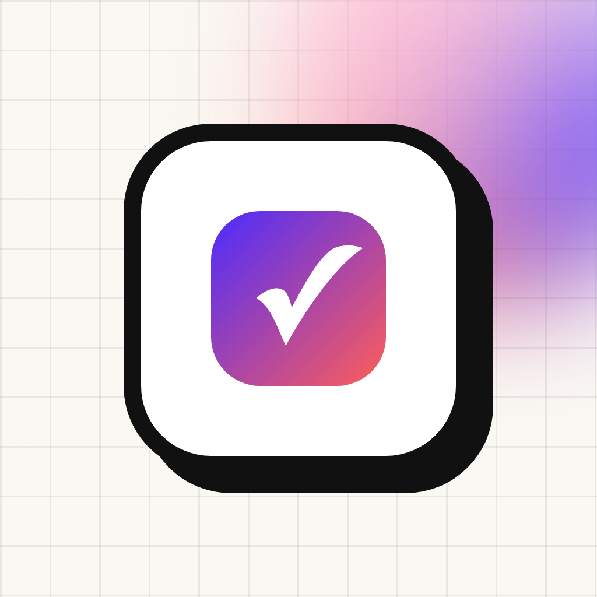
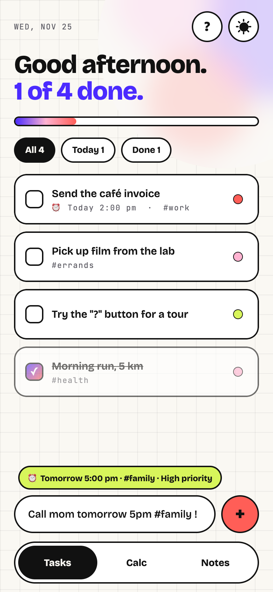
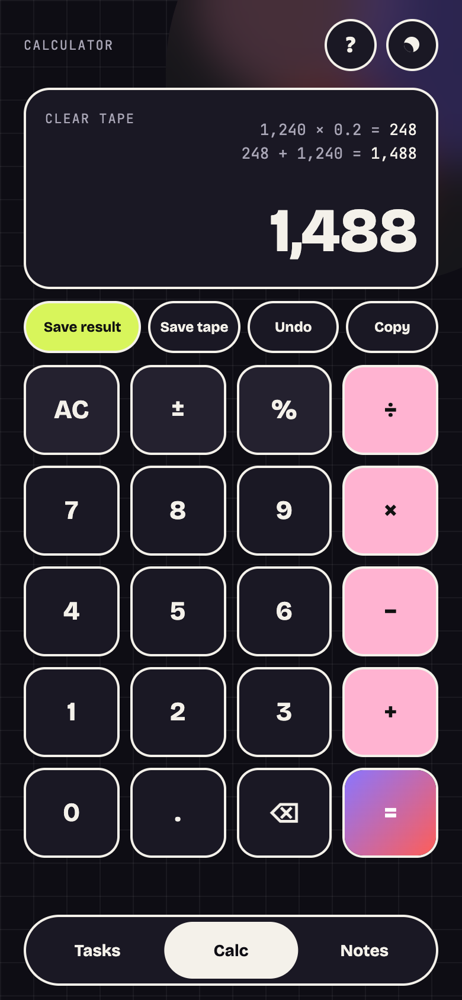
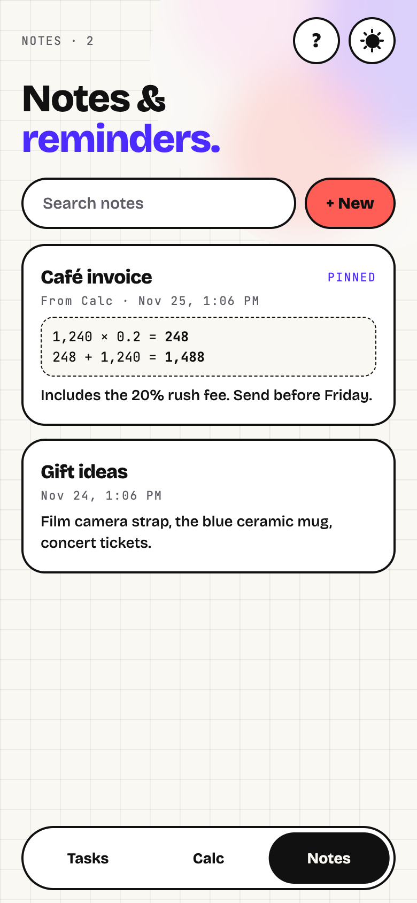
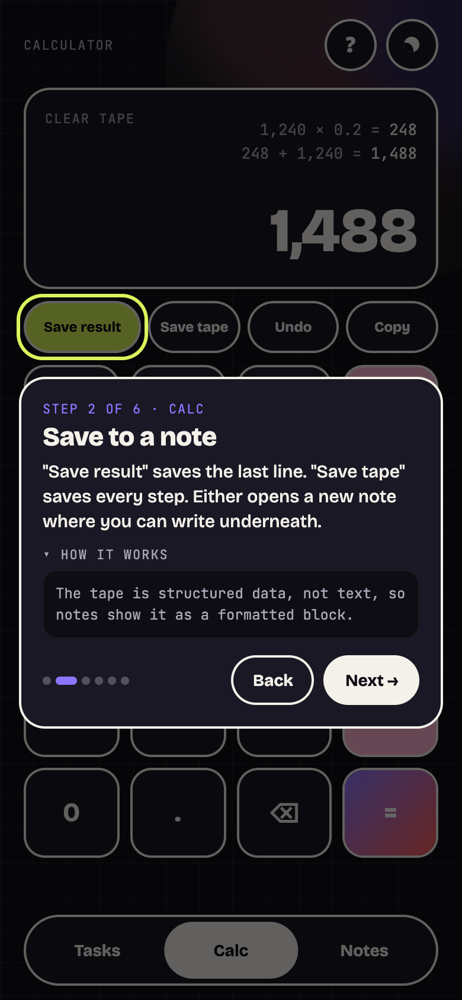

<div align="center">



# Daypad

**Tasks, a calculator with a running tape, and notes with reminders, in one app.**

[Live demo](https://daypad.vercel.app) · [Feature walkthrough](#feature-walkthrough) · [Audit report](docs/AUDIT.md)


</div>

<p align="center">
  
  
  
  
</p>

## Overview

Daypad is a small productivity app for the things you jot down during a day: what to do, a quick sum, and a note to remember it by. A task typed as "Call mom tomorrow 5pm #family !" gets its due time, tag and priority automatically. A calculation can be saved to a note with one tap, as just the answer or the whole tape, and you can write underneath it. Notes can carry a reminder.

It runs on iOS, Android and the web from one TypeScript codebase. It works offline, follows the device's light or dark setting, and has a **"?" button** on every screen that walks through each control and explains how it works under the hood.

This repository started in 2023 as a single-screen React Native tutorial to-do list. Version 2 is a full rebuild: new architecture, state layer, design system, features and tests. The original commits are kept in the history.

## Feature walkthrough

### Tasks

- **Smart quick add.** Dates (`today`, `tonight`, `tomorrow`), 12 and 24 hour times (`5pm`, `14:30`), `#tags` and `!` for high priority are parsed as you type, and a preview chip shows what was understood before you add the task. A time already past today rolls to tomorrow.
- **Check, edit, prioritise.** Tap the box to complete a task, press and hold the text to edit it inline, and tap the coloured dot to cycle priority.
- **Swipe to delete, with Undo.** A spring-driven pan gesture. The deleted task returns to the same position.
- **Filters and progress.** All, Today (due today or overdue) and Done, with live counts, a headline that updates ("3 of 5 done", "All done") and an animated gradient progress bar.
- **Smart sorting.** Open tasks first, then by priority, then by due time. Finished tasks sink to the bottom. Overdue tasks are labelled in red.

### Calculator

- **Running tape.** Every "=" adds a line to the tape, so you can see how you reached an answer.
- **Correct maths.** Operator precedence (`2 + 3 × 4 = 14`), floating point noise removed (`0.1 + 0.2 = 0.3`), desk-calculator percent (`200 + 10 % = 220`), divide by zero handled, thousands grouped.
- **Undo, step by step.** Undo rewinds one key press at a time (60 steps), even after "=". Long-press ⌫ clears.
- **Save to a note.** "Save result" saves the last line and "Save tape" saves every step. Either one opens a new note with the cursor ready under the calculation.
- **Keyboard support on the web.** Numbers, `+ − * /`, Enter, Backspace, Esc and Cmd or Ctrl + Z.

### Notes and reminders

- **Write under a calculation.** Saved calculations render as a formatted, copyable block with your text below.
- **Reminders.** In 1 hour, Tonight 8 pm or Tomorrow 9 am. On phones they are scheduled local notifications. On the web the app shows a banner and a browser notification while the tab is open.
- **Pin, search, delete with Undo.** Pinned notes stay on top. Search is case and accent insensitive and also searches inside saved calculations. An empty new note is discarded when you close it.

### Across the app

- **Light and dark mode.** A sun and moon toggle that morphs between icons, with a circular reveal animation. Starts from the device setting and remembers your choice.
- **The "?" guided tour.** A highlight ring springs to each control while a card explains what it does, with a "How it works" note on the implementation. Each tab has its own steps. On the web it works with the arrow keys, Enter and Esc.
- **Motion.** Springs for presses, toggles and the tab indicator. Layout animations when rows enter, leave and reorder. Screens slide in the direction of the tab you chose. A slowly drifting mesh gradient. Everything respects the system "reduce motion" setting.
- **Offline and private.** All data stays on the device. Nothing is sent anywhere.

## Design

The look borrows from playful editorial interfaces: graph paper, thick black outlines with offset shadows, pill buttons and sticker-like colour, with a blurred multicolour mesh gradient for depth. The approved mockup is in [`design/mockup-v1.png`](design/mockup-v1.png).

| Token | Light | Dark | Use |
|---|---|---|---|
| Paper / Night | `#FAF8F3` | `#0E0D14` | Background with a 28 px grid |
| Ink | `#111111` | `#F4F1EA` | Text and outlines |
| Violet | `#4B2BFF` | `#8A75FF` | Accent text, gradients |
| Coral | `#FF5E57` | `#FF5E57` | Primary actions |
| Pink | `#FFB3D1` | `#FFB3D1` | Operator keys |
| Lime | `#D8F55B` | `#D8F55B` | Saved and active states, reminders |

Type is **Bricolage Grotesque** for headings and interface, and **JetBrains Mono** for numbers, labels and the tape. Colours, spacing, radii, type and motion live in one token file ([`src/theme/tokens.ts`](src/theme/tokens.ts)) and components never hardcode a hex value.

## Built with

| Area | Technology |
|---|---|
| App | React Native 0.88, Expo SDK 58, React 19, TypeScript (strict) |
| State | Zustand stores with `persist` middleware on AsyncStorage (localStorage on the web) |
| Motion | Reanimated 4 (springs, layout animations, UI-thread worklets) |
| Gestures | React Native Gesture Handler |
| Platform | expo-notifications, expo-haptics, expo-clipboard, expo-blur, expo-linear-gradient, expo-font |
| Quality | ESLint (eslint-config-expo), `tsc --noEmit`, Node's built-in test runner |
| Hosting | Vercel (static web export) |

## Architecture

```text
App.tsx                 fonts, store hydration, shell, tab transitions, overlays
src/
  lib/
    calc.ts             calculator engine: a pure reducer with precedence, undo and tape
    parseTask.ts        natural language quick add and due date formatting
    reminders.ts        native notifications (reminders.web.ts for browsers)
    useNow.ts           ticking clock for overdue and "today" states
  store/                Zustand stores: tasks, notes, calc, ui (tab, theme, tour, toast)
  screens/              TasksScreen, CalcScreen, NotesScreen
  components/           TaskItem, NoteEditor, TabBar, Header, HelpTour, Toast,
                        ThemeReveal, Backdrop, Bouncy, ReminderWatcher, tour.ts
  theme/                design tokens and useTheme()
tests/                  unit tests for the calculator engine and the task parser
design/                 approved mockup and app icon source
```

**Decisions worth noting**

- **Logic is pure and tested apart from the UI.** The calculator is a reducer (`state, action → state`) and the parser is a pure function with an injectable clock, so both run under Node's test runner with no React Native mocks.
- **One store per concern.** Tasks, notes, the calculator and UI state are separate Zustand stores. Components subscribe with selectors and `useShallow`, so a key press on the calculator doesn't re-render the task list. Each store persists only what should survive a restart (the undo stack and toasts don't).
- **Platform files instead of runtime checks.** `reminders.ts` and `reminders.web.ts` share one interface, and Metro picks the right file per platform.
- **State-driven tabs instead of a router.** Three peer tools with no deep links don't need URL routing, and keeping the active tab in the store lets the tour, toasts and "Save to note" switch tabs directly.
- **The tour measures the real UI.** Components register their views with `useTourTarget('key')`, and the overlay measures them on screen, so highlights stay accurate at any screen size and in both themes.

## Getting started

Requires Node 20.19 or newer.

```bash
npm install
npm run web        # open in the browser
npm run ios        # iOS simulator (development build)
npm run android    # Android emulator (development build)
```

| Script | What it does |
|---|---|
| `npm start` | Start the Expo dev server |
| `npm test` | Run the unit tests (calculator engine and task parser) |
| `npm run lint` | ESLint with the Expo config |
| `npm run typecheck` | TypeScript in strict mode |
| `npm run web:build` | Export the static web build to `dist/` |

Reminders on iOS and Android use native notification modules, so test them in a development build (`npx expo run:ios`) rather than Expo Go.

## Accessibility

- Every control has a role and a label. Checkboxes, tabs, filters and toggles expose their checked, selected or pressed state.
- Tap targets are at least 44 points, and text meets WCAG AA contrast in both themes.
- Live regions announce the calculator result, the quick add preview and toasts.
- Tasks offer Edit and Delete as accessibility actions, so swiping is never the only way.
- Motion follows the system "reduce motion" setting, including the theme reveal.

## Testing and audit

18 unit tests cover operator precedence, floating point rounding, percent, negate, backspace, chaining, undo, input limits and divide by zero, plus natural language dates, times, tags and priority. The app was also tested end to end in the browser at 375, 390, 420 and 1280 px wide. Findings and fixes are in the [audit report](docs/AUDIT.md).

<div align="center">

Designed and built by **Ayla Basha** · [LinkedIn](https://www.linkedin.com/in/aylabasha/)

</div>
